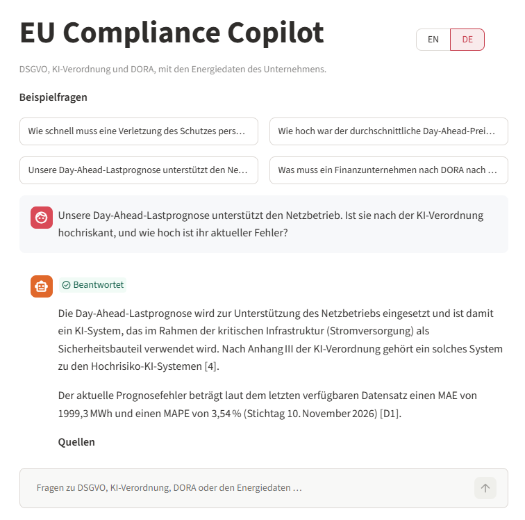
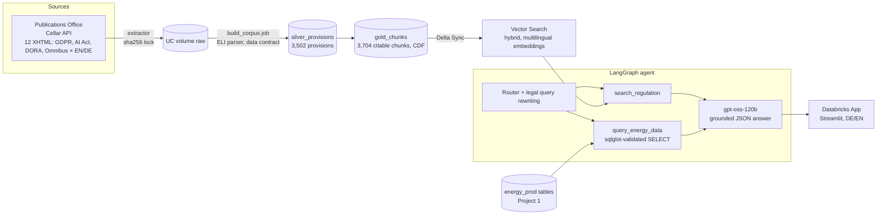

# EU Compliance Copilot

Bilingual (EN/DE) assistant for **GDPR, the EU AI Act (as amended by the Digital Omnibus 2026/1744) and DORA** — answers with article-level citations from the official texts, and combines them with a company's operational data. Built on Databricks with production practices: infrastructure as code, least-privilege identities, CI/CD, and an evaluation gate.

> Not legal advice. Sources: EUR-Lex — AI Act consolidated 27.07.2026, GDPR consolidated 04.05.2016, DORA OJ L 333/2022.

## What it does

- **"How quickly must a personal data breach be notified?"** → *without undue delay, not later than 72 hours* — citing GDPR Art. 33(1) with a deep link to EUR-Lex.
- **"Innerhalb welcher Frist muss eine Datenpanne gemeldet werden?"** → German answer from the German text, citing DSGVO Art. 33 Abs. 1.
- **"Our day-ahead load forecast supports grid operations. Could it be high-risk under the AI Act, and what is its current error?"** → AI Act Annex III (critical infrastructure) **and** the live forecast error from the energy platform ([energy-lakehouse-de](https://github.com/tutul032/energy-lakehouse-de)) via a guarded SQL tool.
- **"What does NIS2 require?"** → recognised as out of scope; legal-advice and prompt-injection requests are refused.

## Architecture

## Evaluation

40-question set (`eval/questions.yaml`): 11 GDPR, 10 AI Act, 8 DORA, 3 cross-regulation, 4 data/tool, 4 adversarial; 9 in German. Every change is an MLflow run; decisions are recorded as ADRs.

| Stage | Metric | Result |
|---|---|---|
| Retrieval (ADR-0004) | recall@5 / recall@10 | 0.882 / 0.912 |
| RAG (ADR-0005) | behavior / citation hit / key facts / p95 | 1.000 / 0.882 / 0.829 / 5.5 s |
| **Agent, dev, all 40 (ADR-0006)** | route / data / behavior / citation hit / key facts | **1.000 / 1.000 / 1.000 / 0.912 / 0.847** |
| **Release gate, staging, 36 (ADR-0007)** | safety / answer rate / citation hit / key facts / errors / p95 | **1.000 / 0.969 / 0.879 / 0.778 / 0 / 8.8 s** |

Variance across repeated release runs of the same system: citation hit 0.879–0.909, key facts 0.778–0.880, behavior 0.972–1.000. The release gate therefore checks **safety strictly** (refusals, out-of-scope, false premises = 1.0) and **quality with a margin** (answer rate ≥ 0.95, citation hit ≥ 0.85, key facts ≥ 0.75, errors = 0).

## Engineering

| Area | How |
|---|---|
| Data | Official sources via the Publications Office machine interface (Cellar); EUR-Lex website blocks scripts — not worked around. Versioned manifest + sha256 lock file; data contract on article/recital/annex counts |
| Parsing | Structure-aware: ELI ids for articles and paragraphs, two markup variants (consolidated, Official Journal), amendment markers kept as metadata |
| Retrieval | Hybrid search, language + unit-type filters, per-regulation retrieval, small-to-big context with size caps |
| Generation | JSON status contract, citation verification, grounding guardrail (`unsupported`), retries on transient errors |
| Agent | LangGraph with explicit router and query rewriting; SQL tool restricted by whitelist + sqlglot validator |
| Infrastructure | Terraform: schemas, volumes, service principals, least-privilege grants (non-authoritative on shared securables) |
| Delivery | Databricks Asset Bundles; GitHub Actions: tests, bundle validation as the CI identity, corpus refresh and release evaluation on staging — no laptop deploys to staging/prod |
| App | Databricks App running as its own service principal; wheel installed from a UC volume |

## Reproduce

Step-by-step tutorials with real outputs and troubleshooting: [`docs/tutorial/`](docs/tutorial/) (00 foundation → 07 release). Decisions: [`docs/adr/`](docs/adr/). Operations: [`docs/runbook.md`](docs/runbook.md). Model card and risk log: [`docs/model-card.md`](docs/model-card.md).

## Limitations and next steps

- Scope: GDPR, AI Act, DORA only — no national law, delegated acts or case law.
- Known weak spots are listed in the risk log (e.g. credit-scoring obligations, conditions in high-risk classification).
- Next: port retrieval and generation to Azure AI Search + Azure OpenAI and compare on the same evaluation; MCP server for the tools; per-PR evaluation gate.

## Licence

Code: MIT. Legal texts: © European Union, https://eur-lex.europa.eu/, reused under Commission Decision 2011/833/EU. Runs on Databricks Free Edition (non-commercial).
